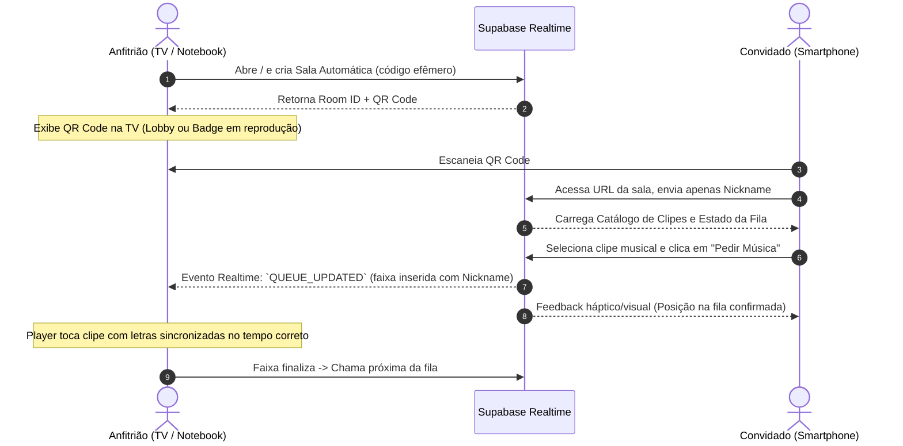
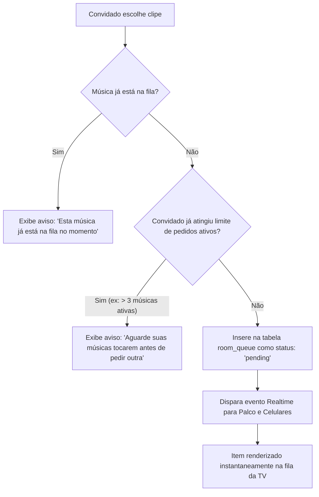

# Cante — Documentação de Arquitetura, Funcional e Técnica

**Versão:** 1.0.0  
**Status:** Aprovado para Desenvolvimento  
**Data:** Novembro de 2026  
**Autor:** Engenharia de Produto & Arquitetura de Software  

---

## 1. Visão Geral e Proposta do Produto

### 1.1 Missão e Proposta de Valor
O **Cante** é uma aplicação web minimalista de videokaraokê colaborativo em tempo real, projetada especificamente para encontros presenciais, ambientes familiares e reuniões em grupo com foco em clipes musicais edificantes (como o repertório audiovisual da JW).

O objetivo central é eliminar qualquer barreira técnica ou fricção de onboarding. Em reuniões sociais, a exigência de cadastros, senhas ou downloads de aplicativos destrói o ritmo e o engajamento coletivo. O Cante substitui esse atrito por uma experiência imediata de "escanear e usar" (*scan-and-play*).

```
┌────────────────────────────────────────────────────────────────────────┐
│                          SESSÃO PRESENCIAL                             │
│                                                                        │
│   ┌───────────────────────────┐         ┌──────────────────────────┐   │
│   │   PALCO / EXIBIÇÃO        │         │ CONTROLE REMOTO          │   │
│   │   (Notebook conectado à   │         │ (Smartphones dos         │   │
│   │    TV da Sala)            │         │  Convidados via Web)     │   │
│   │                           │         │                          │   │
│   │ • Player de Vídeo HD      │ Realtime│ • Busca instantânea      │   │
│   │ • Letras Sincronizadas    │◄───────►│ • Fila de pedidos        │   │
│   │ • Fila de Reprodução      │Supabase │ • Apelido do cantor      │   │
│   │ • QR Code de Acesso       │         │ • Zero cadastro / login  │   │
│   └───────────────────────────┘         └──────────────────────────┘   │
└────────────────────────────────────────────────────────────────────────┘
```

### 1.2 Topologia de Sessão (Dual-Display Paradigm)
A aplicação opera sob o modelo de **duas faces complementares**:
1. **O Palco (Host / Display View):** Executado em um navegador no computador principal, projetado ou espelhado em uma TV de tela grande com saída de áudio surround/soundbar. É passivo em relação à escolha de faixas e ativo na reprodução contínua e visualização das letras.
2. **O Controle Remoto (Guest Controller View):** Executado no navegador mobile dos convidados via leitura de QR Code. Funciona como catálogo digital, buscador interativo e central de envio de pedidos.

---

## 2. Arquitetura de Telas e Jornada do Usuário

### 2.1 Fluxo Integrado de Interação



---

### 2.2 Interface do Palco (TV / Notebook)

A interface de exibição foi projetada para legibilidade a uma distância de 2 a 5 metros da TV, evitando poluição visual e garantindo imersão cinematográfica.

#### A. Estado de Espera / Lobby Inicial (Sem músicas na fila)
- **Hero Central:** Logotipo minimalista com animação suave de respiração (*breathing glow*).
- **QR Code Dinâmico em Alta Resolução:** Exibido no centro da tela com o código amigável de 4 a 6 caracteres (ex: `CANTE-77`) abaixo dele para entrada manual caso a câmera falhe.
- **Instruções Curtas:** *"Aponte a câmera do seu celular para pedir uma música e cantar junto"*.
- **Música/Vídeo de Fundo Ambience:** Clipes de fundo ou transições dinâmicas sutis para que a tela não pareça estática ou travada.

#### B. Estado de Reprodução Ativa (Karaokê em Andamento)
- **Área do Player de Vídeo (70-80% do viewport):**
  - Reprodução do clipe em alta definição (1080p).
  - Controle de volume discreto, status da faixa e botão de emergência para o host (*Pular Música*, *Pausar*).
- **Motor de Letras Sincronizadas (Lyrics Display Area):**
  - Sobreposição na parte inferior ou painel lateral translúcido.
  - Exibe a linha atual em destaque com cor vibrante e preenchimento progressivo conforme o tempo da voz.
  - Exibe a linha anterior (com opacidade reduzida) e a próxima linha (preview para o cantor se preparar).
- **Painel Lateral da Fila (Live Queue Sidebar):**
  - **Tocando Agora:** Título da música + *Pedido por: [Nickname]*.
  - **A Seguir:** Lista em cartões translúcidos dos próximos pedidos com tempo estimado de espera.
- **Badge Flutuante de Conexão Rápida:** No canto superior direito, um mini QR Code permanente de 80x80px para permitir que convidados atrasados entrem na sala sem interromper quem está cantando.

---

### 2.3 Interface do Controle Remoto (Smartphone)

A interface mobile é focada em velocidade, navegação ergonômica com uma só mão (*thumb-friendly*) e clareza visual.

```
┌────────────────────────────────────────┐
│ ♫ CANTE                [Sala: CANTE-77]│
├────────────────────────────────────────┤
│ Olá, Laura!             [Alterar Nome] │
├────────────────────────────────────────┤
│ 🔍 Buscar clipe, tema ou letra...     │
├────────────────────────────────────────┤
│ [Todos]  [Amizade]  [Família]  [Louvor]│
├────────────────────────────────────────┤
│ CATÁLOGO DISPONÍVEL                    │
│                                        │
│ ┌────────────────────────────────────┐ │
│ │ [Thumb] Alegria que Não Tem Fim    │ │
│ │         Duração: 03:42   [+ Pedir] │ │
│ └────────────────────────────────────┘ │
│ ┌────────────────────────────────────┐ │
│ │ [Thumb] Coragem para Vencer        │ │
│ │         Duração: 04:10   [+ Pedir] │ │
│ └────────────────────────────────────┘ │
├────────────────────────────────────────┤
│ ⌂ Catálogo    |    ♫ Fila Atual (3)    │
└────────────────────────────────────────┘
```

#### A. Tela de Entrada Rápida (Onboarding Zero-Friction)
- Disparada assim que o QR Code é lido.
- Se a URL já possui o código da sala (ex: `/sala/CANTE-77`), a tela solicita apenas:
  - Campo único: *"Como quer ser chamado(a)?"* (Input grande de texto, autofocus).
  - Botão de ação: *"Entrar no Karaokê"*.
- O identificador do convidado e o nickname são persistidos no `localStorage` do celular. Ao reabrir, o usuário já cai direto no catálogo.

#### B. Navegação e Busca
- **Barra de Pesquisa Instantânea:** Filtro em tempo real por título do clipe, palavras-chave e trechos conhecidos da letra.
- **Chips de Categorias / Temas:** Filtros rápidos por tags (ex: *Amizade*, *Crianças*, *Esperança*, *Gratidão*).
- **Card do Clipe:**
  - Thumbnail em miniatura com cantos arredondados.
  - Título oficial da canção.
  - Duração em formato `mm:ss`.
  - Botão interativo proeminente: **"+ Adicionar à Fila"**.

#### C. Visualização da Fila & Meus Pedidos
- Aba dedicada que lista a ordem exata de reprodução da sala.
- Destaca visualmente os pedidos feitos pelo próprio aparelho: *"Seu pedido! Toca daqui a aproximadamente 6 minutos"*.
- Mostra quem solicitou cada faixa por meio de um avatar estilizado ou badge com o nickname.

---

## 3. Identidade Visual e Design System

O design do Cante combina **elegância acolhedora** com uma pegada tecnológica contemporânea. Não possui aspecto corporativo ou genérico; utiliza conceitos refinados de profundidade, desfoque de camadas (*glassmorphism*) e iluminação ambiente.

### 3.1 Paleta de Cores Oficial (Dark Mode Imersivo)

| Nome do Token | Código Hexadecimal | Aplicação Principal |
| :--- | :--- | :--- |
| **Deep Royal Purple** | `#1A1A2E` | Fundo principal da aplicação (Background Canvas) |
| **Royal Purple** | `#4A148C` | Superfícies primárias, cards elevados e botões de destaque |
| **Soft Lavender** | `#9575CD` | Legendas ativas, realces temporais de letra e badges |
| **Pure White** | `#FFFFFF` | Textos primários, títulos e ícones de alto contraste |
| **Subtle Slate** | `#E2E8F0` | Textos secundários, metadados e contornos discretos |
| **Accent Glow** | `rgba(149, 117, 205, 0.25)` | Sombras neon difusas e estados de foco |

### 3.2 Especificação do Efeito Glassmorphism (Vidro Fosco)
As superfícies não utilizam cores sólidas chapadas, mas sim camadas translúcidas combinadas com desfoque de fundo (*backdrop blur*), permitindo que cores dos clipes e gradientes vazem sutilmente:

```css
/* Card Padrão de Vidro */
.glass-card {
  background: rgba(74, 20, 140, 0.25);
  backdrop-filter: blur(16px);
  -webkit-backdrop-filter: blur(16px);
  border: 1px solid rgba(255, 255, 255, 0.08);
  box-shadow: 0 8px 32px 0 rgba(0, 0, 0, 0.37);
  border-radius: 16px;
}

/* Estado Ativo / Item Selecionado */
.glass-card-active {
  background: rgba(149, 117, 205, 0.2);
  border: 1px solid rgba(149, 117, 205, 0.5);
  box-shadow: 0 0 24px rgba(149, 117, 205, 0.35);
}
```

### 3.3 Tipografia
- **Família Tipográfica Principal:** `Plus Jakarta Sans` ou `Inter` (Sans-Serif geométrica, moderna, com altíssima legibilidade em telas de baixa e alta resolução).
- **Escala de Tipografia para a TV (Palco):**
  - Letra Ativa do Karaokê: `48px` a `64px` (Weight 700, tracking -0.02em).
  - Letra Prévia: `28px` a `36px` (Weight 500, opacidade 60%).
  - Título do Clipe: `32px` (Weight 600).
- **Escala de Tipografia Mobile:**
  - Títulos de Seção: `20px` (Weight 700).
  - Nome do Clipe no Card: `16px` (Weight 600).
  - Metadados e Tags: `13px` (Weight 400).

---

## 4. Regras de Negócio e Lógica de Domínio

### 4.1 Ciclo de Vida da Sala (Room Lifecycle)
1. **Criação da Sala:**
   - Ocorre no momento em que a rota do Palco (`/host` ou rota raiz `/`) é inicializada.
   - Um identificador único (`room_id` UUID) e um código de 6 caracteres alfanuméricos legíveis (`room_code`, ex: `JW2026`) são gerados no backend.
   - O código é gerado excluindo caracteres ambíguos (exclui `0`, `O`, `I`, `1` para evitar erros de digitação).
2. **Heartbeat e Expiração:**
   - O Palco emite um *heartbeat* para o banco de dados a cada 30 segundos.
   - Caso uma sala fique sem conexão do host por mais de 30 minutos contínuos, ela é marcada como `inactive` e sua fila é arquivada.
3. **Persistência da Sessão do Host:**
   - O token da sala do host é gravado no `sessionStorage` do computador da TV. Se a página for recarregada sem querer, a sala existente é restaurada imediatamente sem desconectar os celulares.

### 4.2 Identidade dos Convidados (Zero-Friction Identity)
- Nenhum dado pessoal sensível é coletado.
- Ao entrar, um `guest_id` randômico (UUID v4) é atribuído ao navegador do convidado e persistido no `localStorage`.
- O convidado informa apenas seu `nickname` (máximo de 20 caracteres, sanitizado contra HTML/Scripts).
- Se duas pessoas usarem o mesmo apelido, o sistema não bloqueia, mas pode opcionalmente concatenar um sufixo numérico discreto para identificação na fila.

### 4.3 Gestão e Algoritmo da Fila de Reprodução (Queue Management)



- **Fair-Share (Prevenção de Monopólio):**
  - Cada convidado pode ter no máximo **2 a 3 músicas pendentes** na fila ao mesmo tempo.
  - Isso garante que uma única pessoa não envie 20 músicas seguidas e domine a noite.
- **Avanço de Fila:**
  - Quando o player do Palco atinge o evento `video_ended`, a música atual tem seu status atualizado para `completed`.
  - A próxima música com menor `position` e status `pending` muda para `playing`.
- **Poderes do Anfitrião (Host Privileges):**
  - O Palco possui botões de controle protegidos (ou uma interface restrita para o host no celular via chave de criador):
    - *Pular Música (Skip)*: Marca a atual como `skipped` e inicia a próxima.
    - *Excluir da Fila*: Remove qualquer faixa indesejada.
    - *Reordenar*: Permite arrastar faixas na fila caso seja necessário priorizar alguém.

### 4.4 Sincronização e Formato das Letras (Lyrics Engine)
- As letras são armazenadas no formato estruturado de timecodes (baseado em especificação `.lrc` ou JSON timestamped):
  ```json
  [
    { "time": 12.50, "duration": 3.20, "text": "Quando a tempestade vem nos assustar" },
    { "time": 15.90, "duration": 4.10, "text": "Não temos medo, vamos confiar" }
  ]
  ```
- O player escuta o evento de `timeupdate` em alta precisão (usando `requestAnimationFrame`) e calcula o índice da linha ativa, ativando a classe de gradiente em `#9575CD` no momento exato do canto.

---

## 5. Stack Tecnológica e Arquitetura de Dados

### 5.1 Stack Recomendada

| Camada | Tecnologia Escolhida | Justificativa Técnica |
| :--- | :--- | :--- |
| **Frontend Framework** | **Next.js 14+ (React) / TypeScript** | Excelente suporte a SSR/SSG para páginas estáticas de catálogo, rotas dinâmicas por sala (`/sala/[code]`) e tipagem estrita com TS. |
| **Estilização** | **Tailwind CSS + Tailwind Animate** | Facilidade extrema para criar o Design System, tokens customizados (`#1A1A2E`, `#4A148C`, `#9575CD`) e utilitários de glassmorphism. |
| **Animações** | **Framer Motion** | Transições de entrada e saída na fila da TV, animações de preenchimento de letra e microinterações no celular. |
| **Backend & Realtime** | **Supabase (PostgreSQL + Realtime)** | Elimina a necessidade de gerenciar servidores WebSocket próprios. O engine de *Postgres Changes* sincroniza a fila com latência sub-100ms. |
| **Player de Vídeo** | **HTML5 Video Player / YouTube IFrame API** | Compatibilidade universal com codecs de streaming (HLS/DASH/MP4) e players embarcados oficiais. |
| **QR Code Engine** | **qrcode.react (SVG Mode)** | Renderização vetorial cristalina em qualquer resolução de TV sem perda de nitidez. |

---

### 5.2 Modelo de Dados Relacional (PostgreSQL / Supabase Schema)

```sql
-- Extensões necessárias
CREATE EXTENSION IF NOT EXISTS "uuid-ossp";

-- 1. Tabela de Salas
CREATE TABLE rooms (
    id UUID PRIMARY KEY DEFAULT uuid_generate_v4(),
    code VARCHAR(8) UNIQUE NOT NULL,
    host_token UUID NOT NULL DEFAULT uuid_generate_v4(),
    is_active BOOLEAN NOT NULL DEFAULT TRUE,
    created_at TIMESTAMP WITH TIME ZONE DEFAULT timezone('utc'::text, now()) NOT NULL,
    last_heartbeat TIMESTAMP WITH TIME ZONE DEFAULT timezone('utc'::text, now()) NOT NULL
);

-- Índice para busca rápida de salas pelo código do QR Code
CREATE INDEX idx_rooms_code ON rooms(code);

-- 2. Tabela de Clipes Musicais (Catálogo)
CREATE TABLE songs (
    id UUID PRIMARY KEY DEFAULT uuid_generate_v4(),
    title VARCHAR(255) NOT NULL,
    category VARCHAR(100) NOT NULL,
    duration_seconds INTEGER NOT NULL,
    video_url TEXT NOT NULL,
    thumbnail_url TEXT NOT NULL,
    lyrics_data JSONB NOT NULL, -- Array de objetos {time, duration, text}
    tags TEXT[] DEFAULT '{}',
    created_at TIMESTAMP WITH TIME ZONE DEFAULT timezone('utc'::text, now()) NOT NULL
);

CREATE INDEX idx_songs_title ON songs(title);
CREATE INDEX idx_songs_category ON songs(category);

-- 3. Tabela da Fila de Reprodução da Sala
CREATE TYPE queue_status AS ENUM ('pending', 'playing', 'completed', 'skipped');

CREATE TABLE room_queue (
    id UUID PRIMARY KEY DEFAULT uuid_generate_v4(),
    room_id UUID NOT NULL REFERENCES rooms(id) ON DELETE CASCADE,
    song_id UUID NOT NULL REFERENCES songs(id) ON DELETE CASCADE,
    guest_id UUID NOT NULL,
    guest_nickname VARCHAR(50) NOT NULL,
    status queue_status NOT NULL DEFAULT 'pending',
    position SERIAL,
    requested_at TIMESTAMP WITH TIME ZONE DEFAULT timezone('utc'::text, now()) NOT NULL,
    started_at TIMESTAMP WITH TIME ZONE,
    finished_at TIMESTAMP WITH TIME ZONE
);

CREATE INDEX idx_room_queue_room_status ON room_queue(room_id, status);
```

---

### 5.3 Políticas de Segurança (Row Level Security - RLS)

Como o sistema opera **sem login tradicional**, a segurança é aplicada em nível de banco através de tokens e identificadores anônimos:

1. **Leitura Pública para Clipes:** A tabela `songs` possui leitura irrestrita para qualquer cliente conectado (`SELECT true`).
2. **Leitura e Inserção na Fila:** Qualquer usuário com o `room_id` correspondente a uma sala `is_active = true` pode consultar a fila e inserir novos itens com status `pending`.
3. **Moderação e Transição de Status:** Apenas requisições que apresentem o `host_token` (armazenado no Palco) ou executadas por Edge Functions com Service Role podem alterar itens para `playing`, `completed` ou `skipped`.

---

### 5.4 Arquitetura de Comunicação em Tempo Real

A comunicação entre os controles e o palco utiliza o **Supabase Realtime**:

```
[ Celular do Convidado ]
         │
         │ HTTP POST: Insert em room_queue
         ▼
[ Supabase PostgreSQL ] ──(Wal2JSON CDC)──► [ Realtime Server ]
                                                    │
                                                    │ WebSocket Push
                                                    ▼
                                          [ Palco (TV / Notebook) ]
```

1. **Canal de Sala (`room:{room_id}`):**
   - O Palco se inscreve no canal da sala com filtro para alterações na tabela `room_queue`.
   - Ao receber o evento `INSERT`, o Palco atualiza a UI da lista de espera com animação do Framer Motion.
   - Ao receber o evento `UPDATE` (ex: música atual finalizada), os celulares atualizam suas telas para mostrar o progresso da fila em tempo real.

---

## 6. Próximos Passos de Implementação (Roadmap Técnico)

1. **Fase 1: Configuração do Backend e Dados (Supabase)**
   - Execução do schema DDL de salas, catálogo de clipes e fila.
   - Povoamento do catálogo inicial com dados de clipes e letras sincronizadas de teste.
2. **Fase 2: Motor do Palco (TV / Host)**
   - Criação da página `/host` com geração automática do código da sala e QR Code vetorial.
   - Integração do Player de Vídeo e renderizador de letras sincronizadas com interpolação de tempo.
3. **Fase 3: Controle Mobile (Guest Remote)**
   - Criação da página `/sala/[code]` com tela de entrada com apelido.
   - Construção do catálogo com busca rápida, filtros por categoria e botão "Pedir Música".
   - Conexão com o Supabase Realtime para notificação e atualização de fila.
4. **Fase 4: Polimento Visual e Experiência Glassmorphism**
   - Aplicação minuciosa da paleta `#1A1A2E`, `#4A148C`, `#9575CD` e `#FFFFFF`.
   - Teste em telas de TV de diferentes polegadas e smartphones Android/iOS.
